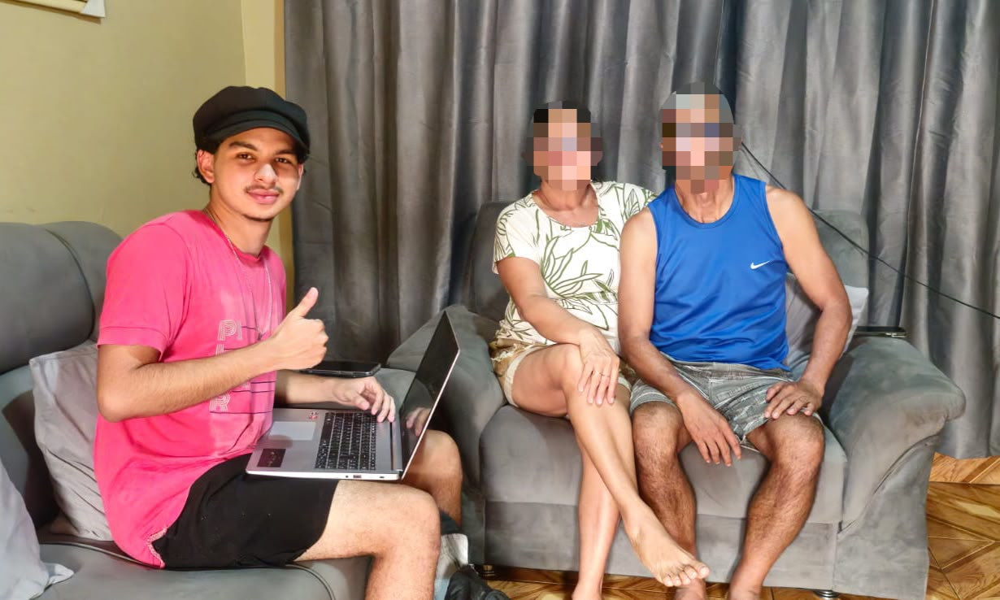

# Briefing com o Cliente

## 1. Roteiro utilizado

O briefing foi conduzido com um roteiro semiestruturado, organizado em 4 blocos e 12 perguntas, complementado por seis pontos sobre as informações mínimas do briefing, apresentados ao final.

**Bloco 1: Experiência com locação de imóveis**

1. Há quanto tempo você trabalha com aluguel de imóveis? Como começou nesse ramo e como funciona atualmente essa atividade?
2. Como você costuma divulgar seus imóveis e encontrar pessoas interessadas em alugá-los? Quais meios utiliza e como funciona esse processo?
3. Quais são as principais dificuldades que você enfrenta durante o processo de locação, desde encontrar interessados até fechar um contrato?
4. Quando alguém demonstra interesse em alugar um imóvel, quais informações ou garantias você considera importantes antes de fechar o negócio?

**Bloco 2: Perfil dos inquilinos e procura por moradia**

5. Qual é o perfil das pessoas que geralmente procuram seus imóveis? Você costuma receber interessados de outras cidades ou pessoas que precisam de moradia por motivos de trabalho ou estudo?
6. Na sua experiência, quais características as pessoas mais procuram em um imóvel para alugar? O que costuma influenciar na decisão de escolher uma moradia?
7. Você já alugou imóveis para estudantes universitários, especialmente aqueles que vêm de outros municípios para estudar? Como foi essa experiência e quais necessidades ou dificuldades percebeu nesse público?

**Bloco 3: Possibilidades de melhoria e plataforma**

8. Você acredita que encontrar pessoas interessadas em alugar imóveis poderia ser mais fácil? O que poderia melhorar nesse processo, tanto para os proprietários quanto para quem procura moradia?
9. Imagine um site ou aplicativo que reunisse imóveis disponíveis para aluguel, permitindo que as pessoas consultassem fotos, preços, localização e informações sobre as condições da moradia. Você considera que uma ferramenta assim seria útil? Por quê?
10. Pensando em uma plataforma como essa, quais recursos ou informações seriam mais importantes para você como proprietário? O que gostaria de conseguir fazer nela?

**Bloco 4: Segurança e funcionamento da plataforma**

11. Quais cuidados você considera necessários para garantir que os anúncios sejam confiáveis e que tanto proprietários quanto interessados sejam pessoas legítimas? Que informações deveriam ser solicitadas no cadastro?
12. Considerando uma plataforma voltada principalmente para estudantes da UFAM que precisam encontrar moradia, você teria interesse em anunciar seus imóveis nela? Existe alguma preocupação, necessidade ou sugestão que deveríamos considerar para que você se sentisse confortável em utilizá-la?

**Pontos complementares**

Além das 12 perguntas, o roteiro incluiu os seguintes pontos, abordados com o mesmo casal:

- Demanda inicial (o que motiva a necessidade de uma solução);
- Prioridades (quais problemas são mais relevantes para os locadores);
- Fontes de informação que ajudam a compreender o contexto;
- Padrão prévio (existência de sistema, processo ou padrão de interface já utilizado);
- Contato técnico (com quem obter informações adicionais);
- Restrições conhecidas (técnicas, institucionais, legais ou operacionais).

---

## 2. Informações coletadas

As informações abaixo organizam o que foi apurado em torno dos itens mínimos do briefing.

| Item | O que foi apurado |
|---|---|
| **Demanda inicial** | Hoje a divulgação dos imóveis depende de indicações de terceiros, sem nenhum meio centralizado que conecte locadores e interessados. Os locadores afirmam que uma plataforma permitiria administrar melhor as locações, divulgando os imóveis com as condições oferecidas e facilitando o contato com os interessados. |
| **Para quem** | **Locadores:** proprietários de pequenos imóveis (kitnets e apartamentos) que pretendem alugar somente para estudantes. **Inquilinos:** em sua maioria estudantes vindos de outros municípios (como Parintins, Manaus, Autazes, Coari, Humaitá e Apuí), muitos dependentes de bolsa ou de ajuda da família; também há trabalhadores e um professor. Muitos estudantes são menores de idade, e as **famílias** dos estudantes também são afetadas. |
| **Problemas** | (1) Resistência de alguns interessados à formalização de contrato; (2) desistência após acordo verbal, com vaga reservada sem nenhum sinal ou garantia; (3) falta de dados do inquilino e de seus familiares, o que dificultou o contato em uma situação de emergência; (4) disponibilidade dos imóveis desatualizada, fazendo o interessado gastar crédito com ligações. Também foram citados: dificuldade de confirmar que o interessado é realmente estudante; interessados que não visitam o imóvel e só veem fotos; e a falta de mobília, que é fornecida pelos locadores em muitos casos. |
| **Prioridades** | Segundo os locadores, os problemas acima aparecem na ordem de importância: contrato, desistências após acordo verbal, falta de dados do inquilino e disponibilidade desatualizada. |
| **Fontes de informação** | O contrato de locação utilizado pelos locadores; o contato com os pais e familiares dos estudantes, que segundo os locadores ajuda muito a entender o contexto do inquilino; e a experiência de outros locadores da região. |
| **Padrão prévio** | Não existe sistema, processo formal ou padrão de interface em uso. O processo atual é informal: divulgação por indicação, envio de fotos do imóvel ao interessado, combinação das condições de pagamento (água não cobrada; energia paga pelo consumo, com a conta no nome do inquilino) e, quando aceito pelo inquilino, contrato. |
| **Contato técnico** | O próprio casal de locadores, que participou do briefing, e outro locador da região, indicado por eles. |
| **Restrições** | Os locadores exigem contrato; segundo eles, não existe regra específica para locação a menores de idade (no caso relatado, os pais acompanharam o início da locação). Pretendem alugar somente para estudantes. A disponibilidade dos imóveis dependeria de eles manterem a informação atualizada. O uso de dados pessoais no cadastro (CPF, contato de familiares) ainda precisa ser verificado do ponto de vista legal. |

---

## 3. Síntese das principais informações obtidas

A divulgação dos imóveis ocorre principalmente por indicações de terceiros, o que evidencia a ausência de um meio centralizado para conectar proprietários e interessados. A maior parte dos inquilinos é composta por estudantes de outros municípios, embora os locadores também recebam trabalhadores em geral.

Entre as principais dificuldades relatadas, destacam-se a resistência de alguns interessados à formalização de contratos, as desistências após acordos verbais, a dificuldade de verificar informações sobre os possíveis inquilinos e a falta de atualização sobre a disponibilidade dos imóveis. Os entrevistados ressaltaram a importância de disponibilizar fotografias, informações sobre mobília, condições da moradia e despesas adicionais, além de demonstrarem preocupação com a segurança e com a identificação dos usuários. Citaram o CPF e o contato dos pais ou responsáveis como informações úteis no cadastro, e relataram um caso em que a falta de dados da família de um inquilino dificultou o contato após um acidente.

Quanto à proposta de uma plataforma digital, os locadores manifestaram interesse em funcionalidades que permitam cadastrar e divulgar imóveis, atualizar a disponibilidade, receber notificações de interessados e facilitar a comunicação entre as partes. Indicaram ainda que a principal expectativa é administrar melhor as locações e confirmaram que não há padrão prévio de sistema ou interface, que as prioridades seguem a ordem apresentada na seção anterior, e que o contrato é uma exigência deles.

A entrevista evidenciou a necessidade de facilitar a divulgação dos imóveis, centralizar informações e melhorar a comunicação entre proprietários e interessados, com destaque para a segurança, a confiabilidade dos cadastros e a atualização da disponibilidade.

---

## 4. Questões que ainda precisam ser investigadas

- A perspectiva dos **estudantes** e demais interessados em moradia, que ainda não foi ouvida e será investigada na pesquisa com usuários.
- Como a plataforma deve tratar a locação para **menores de idade**, já que os locadores afirmam não haver regra específica, mas isso não foi verificado em fonte jurídica.
- Quais **dados pessoais** podem ser solicitados no cadastro (CPF, comprovação de estudante, contato de familiares) e como tratá-los conforme a legislação.
- Como **comprovar que o interessado é estudante**.
- Se os locadores conseguirão **manter a disponibilidade dos imóveis atualizada** na plataforma com a frequência necessária.
- A perspectiva de **outros locadores**, já que as informações vieram de um único casal.

---

## 5. Registro da realização da reunião

| Item | Descrição |
|---|---|
| Data e formato | 15/11/2026 e 16/11/2026, presencial |
| Integrantes da equipe presentes | João Henrique e Rhuan |
| Participantes do cliente | Casal de locadores de imóveis residenciais de Itacoatiara, com cerca de 8 a 10 anos de atuação (identidade preservada: nomes e endereços omitidos) |
| Consentimento | Os participantes foram informados da finalidade acadêmica e consentiram com o registro e o uso das respostas neste trabalho |

