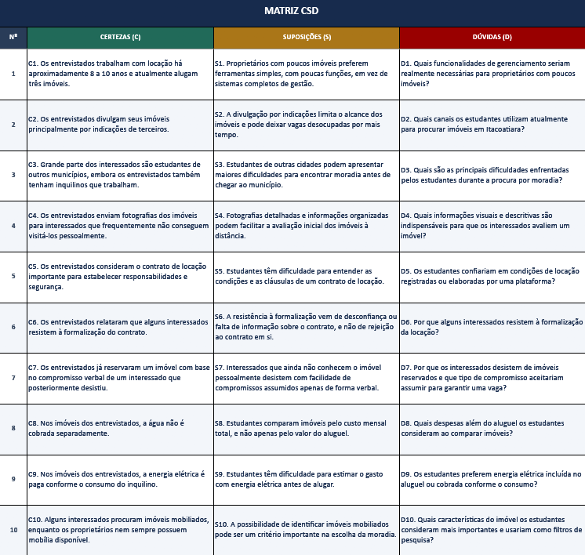
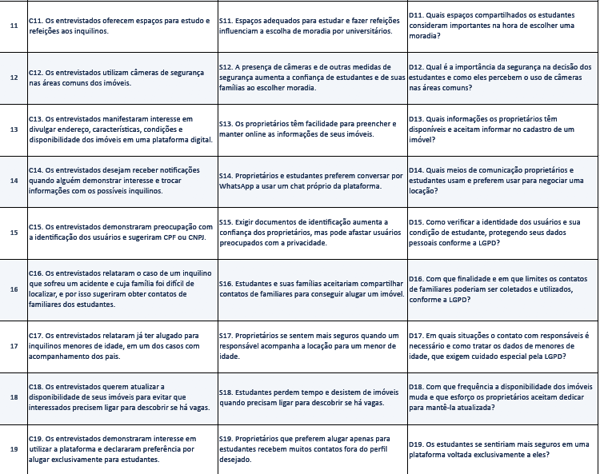

# Matriz CSD

A Matriz CSD organiza as informações obtidas no briefing com o cliente (`1-briefing.md`) em **Certezas**, **Suposições** e **Dúvidas**. As certezas se apoiam no que o casal de locadores relatou, e as suposições e dúvidas orientaram a pesquisa com usuários (`3-pesquisa-com-usuario.md`). Cada linha reúne uma certeza, uma suposição e uma dúvida sobre o mesmo tema.

## Matriz

| Nº | Certezas (C) | Suposições (S) | Dúvidas (D) |
|---|---|---|---|
| 1 | C1. Os entrevistados trabalham com locação há aproximadamente 8 a 10 anos e atualmente alugam três imóveis. | S1. Proprietários com poucos imóveis preferem ferramentas simples, com poucas funções, em vez de sistemas completos de gestão. | D1. Quais funcionalidades de gerenciamento seriam realmente necessárias para proprietários com poucos imóveis? |
| 2 | C2. Os entrevistados divulgam seus imóveis principalmente por indicações de terceiros. | S2. A divulgação por indicações limita o alcance dos imóveis e pode deixar vagas desocupadas por mais tempo. | D2. Quais canais os estudantes utilizam atualmente para procurar imóveis em Itacoatiara? |
| 3 | C3. Grande parte dos interessados são estudantes de outros municípios, embora os entrevistados também tenham inquilinos que trabalham. | S3. Estudantes de outras cidades podem apresentar maiores dificuldades para encontrar moradia antes de chegar ao município. | D3. Quais são as principais dificuldades enfrentadas pelos estudantes durante a procura por moradia? |
| 4 | C4. Os entrevistados enviam fotografias dos imóveis para interessados que frequentemente não conseguem visitá-los pessoalmente. | S4. Fotografias detalhadas e informações organizadas podem facilitar a avaliação inicial dos imóveis à distância. | D4. Quais informações visuais e descritivas são indispensáveis para que os interessados avaliem um imóvel? |
| 5 | C5. Os entrevistados consideram o contrato de locação importante para estabelecer responsabilidades e segurança. | S5. Estudantes têm dificuldade para entender as condições e as cláusulas de um contrato de locação. | D5. Os estudantes confiariam em condições de locação registradas ou elaboradas por uma plataforma? |
| 6 | C6. Os entrevistados relataram que alguns interessados resistem à formalização do contrato. | S6. A resistência à formalização vem de desconfiança ou falta de informação sobre o contrato, e não de rejeição ao contrato em si. | D6. Por que alguns interessados resistem à formalização da locação? |
| 7 | C7. Os entrevistados já reservaram um imóvel com base no compromisso verbal de um interessado que posteriormente desistiu. | S7. Interessados que ainda não conhecem o imóvel pessoalmente desistem com facilidade de compromissos assumidos apenas de forma verbal. | D7. Por que os interessados desistem de imóveis reservados e que tipo de compromisso aceitariam assumir para garantir uma vaga? |
| 8 | C8. Nos imóveis dos entrevistados, a água não é cobrada separadamente. | S8. Estudantes comparam imóveis pelo custo mensal total, e não apenas pelo valor do aluguel. | D8. Quais despesas além do aluguel os estudantes consideram ao comparar imóveis? |
| 9 | C9. Nos imóveis dos entrevistados, a energia elétrica é paga conforme o consumo do inquilino. | S9. Estudantes têm dificuldade para estimar o gasto com energia elétrica antes de alugar. | D9. Os estudantes preferem energia elétrica incluída no aluguel ou cobrada conforme o consumo? |
| 10 | C10. Alguns interessados procuram imóveis mobiliados, enquanto os proprietários nem sempre possuem mobília disponível. | S10. A possibilidade de identificar imóveis mobiliados pode ser um critério importante na escolha da moradia. | D10. Quais características do imóvel os estudantes consideram mais importantes e usariam como filtros de pesquisa? |
| 11 | C11. Os entrevistados oferecem espaços para estudo e refeições aos inquilinos. | S11. Espaços adequados para estudar e fazer refeições influenciam a escolha de moradia por universitários. | D11. Quais espaços compartilhados os estudantes consideram importantes na hora de escolher uma moradia? |
| 12 | C12. Os entrevistados utilizam câmeras de segurança nas áreas comuns dos imóveis. | S12. A presença de câmeras e de outras medidas de segurança aumenta a confiança de estudantes e de suas famílias ao escolher moradia. | D12. Qual é a importância da segurança na decisão dos estudantes e como eles percebem o uso de câmeras nas áreas comuns? |
| 13 | C13. Os entrevistados manifestaram interesse em divulgar endereço, características, condições e disponibilidade dos imóveis em uma plataforma digital. | S13. Os proprietários têm facilidade para preencher e manter online as informações de seus imóveis. | D13. Quais informações os proprietários têm disponíveis e aceitam informar no cadastro de um imóvel? |
| 14 | C14. Os entrevistados desejam receber notificações quando alguém demonstrar interesse e trocar informações com os possíveis inquilinos. | S14. Proprietários e estudantes preferem conversar por WhatsApp a usar um chat próprio da plataforma. | D14. Quais meios de comunicação proprietários e estudantes usam e preferem usar para negociar uma locação? |
| 15 | C15. Os entrevistados demonstraram preocupação com a identificação dos usuários e sugeriram CPF ou CNPJ. | S15. Exigir documentos de identificação aumenta a confiança dos proprietários, mas pode afastar usuários preocupados com a privacidade. | D15. Como verificar a identidade dos usuários e sua condição de estudante, protegendo seus dados pessoais conforme a LGPD? |
| 16 | C16. Os entrevistados relataram o caso de um inquilino que sofreu um acidente e cuja família foi difícil de localizar, e por isso sugeriram obter contatos de familiares dos estudantes. | S16. Estudantes e suas famílias aceitariam compartilhar contatos de familiares para conseguir alugar um imóvel. | D16. Com que finalidade e em que limites os contatos de familiares poderiam ser coletados e utilizados, conforme a LGPD? |
| 17 | C17. Os entrevistados relataram já ter alugado para inquilinos menores de idade, em um dos casos com acompanhamento dos pais. | S17. Proprietários se sentem mais seguros quando um responsável acompanha a locação para um menor de idade. | D17. Em quais situações o contato com responsáveis é necessário e como tratar os dados de menores de idade, que exigem cuidado especial pela LGPD? |
| 18 | C18. Os entrevistados querem atualizar a disponibilidade de seus imóveis para evitar que interessados precisem ligar para descobrir se há vagas. | S18. Estudantes perdem tempo e desistem de imóveis quando precisam ligar para descobrir se há vagas. | D18. Com que frequência a disponibilidade dos imóveis muda e que esforço os proprietários aceitam dedicar para mantê-la atualizada? |
| 19 | C19. Os entrevistados demonstraram interesse em utilizar a plataforma e declararam preferência por alugar exclusivamente para estudantes. | S19. Proprietários que preferem alugar apenas para estudantes recebem muitos contatos fora do perfil desejado. | D19. Os estudantes se sentiriam mais seguros em uma plataforma voltada exclusivamente a eles? |

## Como a matriz orientou a pesquisa com usuários

As suposições e dúvidas voltadas aos estudantes viraram perguntas do formulário. A tabela mostra a ligação entre cada item da matriz e as perguntas que o investigaram.

| Itens da matriz | Perguntas do formulário |
|---|---|
| S2 / D2 (canais de busca e alcance dos imóveis) | 4. Canais que você usou; 5. Maiores dificuldades |
| S3 / D3 (dificuldades de quem vem de fora) | 2. De onde você é; 5. Maiores dificuldades; 6. Vaga descoberta só depois do contato |
| S4 / D4 (fotos e informações do anúncio) | 8. Informações indispensáveis num anúncio |
| S5 (dificuldade com cláusulas) | 10. Dificuldade para entender as cláusulas de um contrato |
| D5 (confiança em condições registradas) | 11. Confiança numa plataforma que registre as condições da locação |
| S8 / D8 (custo mensal total e despesas) | 7. Itens mais importantes; 9. Ao comparar imóveis, o que olha |
| S10 / D10 e S11 / D11 (mobília e espaços compartilhados) | 7. Itens mais importantes |
| S12 / D12 (segurança) | 5. Maiores dificuldades; 7. Itens mais importantes |
| S14 / D14 (meio de comunicação) | 13. Preferência para negociar com o proprietário |
| S15 / D15 e S16 / D16 (documentos e contato de familiar) | 12. O que aceitaria informar para criar conta |
| S18 (vaga descoberta por ligação) | 6. Vaga descoberta só depois de ligar ou mandar mensagem |
