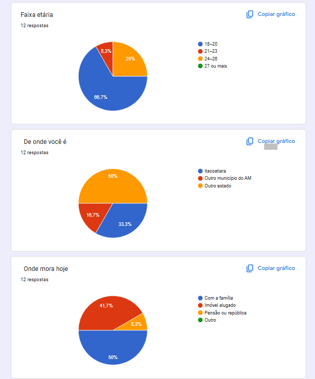
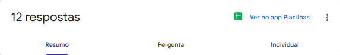
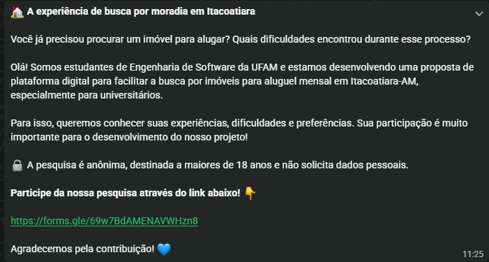

# Pesquisa com Usuários

## 1. Roteiro utilizado

A pesquisa complementa a visão dos locadores obtida no briefing, ouvindo estudantes e outros interessados em moradia, e investiga as suposições e dúvidas da Matriz CSD (`2-matriz-csd.md`). Foram aplicados dois instrumentos: um formulário online e uma entrevista com um participante com necessidade de acessibilidade.

### 1.1 Formulário online (17/11)

O formulário abre com um texto que contextualiza a busca por moradia em Itacoatiara, explica que o grupo desenvolve uma plataforma digital de locação mensal de imóveis residenciais, convida à participação (com ou sem experiência prévia na busca) e informa que não há respostas certas ou erradas. Não pede nome, e-mail nem telefone.

**Perfil**

1. Faixa etária. *(18–20, 21–23, 24–26)*
2. De onde você é? *(Itacoatiara, Outro município do AM, Outro estado)*
3. Onde mora hoje? *(Com a família, Imóvel alugado, Pensão ou república)*

**Procura por moradia**

4. Canais que você usou. *(caixas de seleção: Indicação de amigos, Grupos de WhatsApp ou Facebook, Instagram, Sites (OLX etc.), Placas, Corretor)*
5. Maiores dificuldades. *(caixas de seleção: Preço, Poucas opções, Poucas fotos ou informações, Não poder visitar antes, Desconfiança de quem anuncia, Contrato, Segurança, Vaga já ocupada)*
6. Você já descobriu que não havia mais vaga só depois de ligar ou mandar mensagem? *(Nunca, Poucas vezes, Muitas vezes)*

**O que pesa na escolha**

7. Itens mais importantes ao escolher um imóvel (escolha até 4). *(caixas de seleção: Valor, Distância da universidade, Mobiliado, Internet, Espaço para estudar, Cozinha, Segurança, Água e energia incluídas)*
8. Informações indispensáveis num anúncio. *(caixas de seleção: Fotos de todos os cômodos, Endereço e mapa, Valor total mensal, O que está incluso, Regras da casa, Contato do proprietário)*
9. Ao comparar imóveis, você olha principalmente. *(O valor do aluguel, O custo mensal total)*

**Contrato e confiança**

10. O quão você tem dificuldade para entender as cláusulas de um contrato de locação? *(escala de 1 a 5)*
11. O quão você confiaria numa plataforma que registrasse as condições da locação? *(escala de 1 a 5)*
12. Para criar conta, o que você aceitaria informar? *(caixas de seleção: CPF, Comprovante de estudante, Contato de um familiar, Nenhum deles)*
13. Para negociar com o proprietário, você prefere. *(WhatsApp, Chat do aplicativo, Ligação)*

**Experiência com tecnologia**

14. Quais partes das aplicações que você usa para procurar moradia você gosta? Por quê?
15. Quais partes você não gosta? Por quê?
16. Em quais dispositivos você usa essas aplicações?
17. Como você aprende a usar uma aplicação (perguntando a outras pessoas, pesquisando, lendo manuais, mexendo na aplicação)?
18. Você prefere fazer as coisas passo a passo ou usar atalhos?
19. Você lembra melhor das coisas vendo imagens e representações gráficas, lendo texto ou ouvindo áudio?
20. No mundo virtual, você gosta de interação social e de compartilhar acontecimentos ou prefere se manter reservado?

### 1.2 Entrevista com participante com necessidade de acessibilidade (17/11)

Um participante com baixa visão e dificuldade motora nas mãos respondeu às mesmas perguntas por meio de entrevista, junto com o formulário.

---

## 2. Síntese das principais informações obtidas

A pesquisa teve **13 participantes** (12 respostas ao formulário e 1 entrevista de acessibilidade) e é **exploratória**: os números indicam tendências nesta amostra e não permitem generalizar.

### 2.1 Perfil dos participantes

| Característica | Participantes |
|---|---|
| Faixa etária | 18–20 anos: 8; 21–23 anos: 2; 24–26 anos: 3 |
| Origem | Outro estado: 7; Itacoatiara: 4; outro município do AM: 2 |
| Onde mora hoje | Com a família: 7; imóvel alugado: 5; pensão ou república: 1 |

### 2.2 Principais resultados

**Procura por moradia**
- Os canais mais usados são grupos de WhatsApp ou Facebook (7 de 13) e indicação de amigos (5), seguidos de sites como OLX (4), placas (2), corretor (1) e Instagram (1).
- A dificuldade mais citada é o **preço** (10 de 13), seguida de poucas opções (6), poucas fotos ou informações (5) e contrato (4). Segurança, não poder visitar antes e desconfiança de quem anuncia foram citadas por 3 cada.
- 8 de 13 já descobriram que não havia vaga só depois de ligar ou mandar mensagem (4 poucas vezes e 4 muitas vezes).

**O que pesa na escolha**
- Itens mais importantes: valor (13 de 13), segurança (11), distância da universidade (10) e água e energia incluídas (8). Mobiliado, internet, espaço para estudar e cozinha foram escolhidos por 3 participantes cada.
- Informações indispensáveis num anúncio: endereço e mapa (12), valor total mensal (12), fotos de todos os cômodos (11), o que está incluso (7), contato do proprietário (7) e regras da casa (5).
- 9 de 13 comparam os imóveis pelo custo mensal total, e 4 só pelo valor do aluguel.

**Contrato e confiança**
- A dificuldade para entender contratos é baixa: média 2,0 de 5, com 7 participantes marcando 1.
- A confiança numa plataforma que registre as condições da locação é moderada: média 3,2 de 5, com 6 participantes na posição intermediária (3), 4 em 4 ou 5 e 3 em 1 ou 2.
- Ao criar conta, 12 de 13 aceitam informar ao menos um item: comprovante de estudante (9, mais 1 que aceita somente se necessário), CPF (7) e contato de um familiar (4). Só 1 participante não aceita nenhum.
- Para negociar com o proprietário, 9 preferem WhatsApp, 3 o chat do aplicativo e 1 a ligação.

**Estudantes de fora x de Itacoatiara**
- Os 9 participantes de fora de Itacoatiara citaram o preço como principal dificuldade (8 de 9), e poucas opções (2), poucas fotos ou informações (1) e não poder visitar antes (1) apareceram pouco.
- Os 4 participantes de Itacoatiara apontaram poucas opções e poucas fotos ou informações (4 de 4) e metade (2 de 4) descobriu muitas vezes que a vaga não estava disponível só depois do contato.

**Experiência com tecnologia (respostas predominantes por grupo)**

| | Estudantes de fora (8) | Estudantes de Itacoatiara (4) | Participante com acessibilidade (1) |
|---|---|---|---|
| Dispositivo | Celular | Celular e laptop | Celular e laptop |
| Como aprende | Mexendo e aprendendo | Pesquisando e mexendo nas aplicações | Pesquisando e mexendo nas aplicações |
| Ritmo | Prefere atalhos | Prefere atalhos | Prefere passo a passo |
| Memoriza melhor | Com imagens | Lendo texto | Com representações gráficas e texto |
| Interação virtual | Gosta de interação moderada | Gosta de interação virtual | Prefere se manter reservado |

Entre as partes de aplicações de que gostam, o único destaque foi olhar os grupos de WhatsApp, por ser prático (Itacoatiara). Entre as de que não gostam, os estudantes de fora citaram ter que verificar casas novas todos os dias.

**Participante com necessidade de acessibilidade**
- Relatou baixa visão e dificuldade motora nas mãos.
- Destacou a falta de informações nos anúncios, o contrato e a segurança como dificuldades, e já descobriu muitas vezes que a vaga não estava disponível só depois do contato.
- Considerou indispensáveis o valor total mensal, o endereço e o mapa, e o que está incluso. Aceita informar CPF e contato de um familiar, e o comprovante de estudante somente se necessário.

### 2.3 O que a pesquisa indica sobre a Matriz CSD

As situações abaixo se referem às suposições (S). As dúvidas (D) de cada linha são respondidas, quando possível, na coluna de resultados.

| Item | Resultado da pesquisa | Situação |
|---|---|---|
| S1 / D1 | A pesquisa ouviu estudantes, não proprietários. O briefing aponta poucas funções pedidas (divulgar, atualizar disponibilidade, avisar interessados, trocar mensagens), mas de um único casal. | Não testada |
| S2 / D2 | Os estudantes usam vários canais (grupos de WhatsApp ou Facebook: 7; indicação: 5; sites: 4), e 6 de 13 apontam poucas opções. Não foi medido o tempo de vagas desocupadas. | Parcialmente indicada |
| S3 / D3 | As dificuldades dos estudantes de fora são sobretudo o preço (8 de 9). Poucas opções, poucas fotos e não poder visitar apareceram mais entre os de Itacoatiara. Dificuldade principal geral: preço (10 de 13). | Não indicada |
| S4 / D4 | Fotos de todos os cômodos (11 de 13), endereço e mapa (12) e valor total mensal (12) são as informações mais indispensáveis; seguem o que está incluso (7), contato do proprietário (7) e regras da casa (5). Não foi medida a facilidade de avaliação à distância. | Indicada |
| S5 / D5 | A dificuldade com cláusulas é baixa (média 2,0 de 5). A confiança numa plataforma que registre as condições é moderada (média 3,2 de 5). | Não indicada |
| S6 / D6 | O formulário não perguntou por que alguns resistem ao contrato. Contrato foi citado como dificuldade por 4 de 13 e desconfiança de quem anuncia por 3. | Não testada |
| S7 / D7 | O formulário não perguntou sobre desistências nem sobre formas de compromisso aceitas. | Não testada |
| S8 / D8 | 9 de 13 comparam pelo custo mensal total. Água e energia incluídas estão entre os 4 critérios de 8 de 13; outras despesas não foram listadas. | Indicada |
| S9 / D9 | Não foi perguntado se estimam o gasto com energia nem se preferem energia incluída ou por consumo. Indício: água e energia incluídas pesam na escolha de 8 de 13. | Não testada |
| S10 / D10 | Mobiliado foi escolhido por apenas 3 de 13. Os critérios mais citados foram valor (13), segurança (11), distância da universidade (10) e água e energia incluídas (8). | Não indicada |
| S11 / D11 | Espaço para estudar e cozinha foram escolhidos por 3 de 13 cada (5 participantes escolheram ao menos um deles). | Não indicada |
| S12 / D12 | Segurança é o segundo critério mais citado (11 de 13) e foi apontada como dificuldade por 3. A pesquisa não perguntou sobre câmeras nem sobre a influência da família. | Parcialmente indicada |
| S13 / D13 | Não foi testada com proprietários. No briefing, o casal disse aceitar atualizar a disponibilidade dos imóveis. | Não testada |
| S14 / D14 | 9 de 13 estudantes preferem negociar por WhatsApp, 3 pelo chat do aplicativo e 1 por ligação. Os proprietários não foram consultados sobre isso. | Parcialmente indicada |
| S15 / D15 | 12 de 13 aceitam informar ao menos um item para criar conta (comprovante de estudante: 9; CPF: 7). A preocupação com privacidade não foi perguntada. A verificação conforme a LGPD precisa de análise jurídica fora desta pesquisa. | Parcialmente indicada |
| S16 / D16 | Só 4 de 13 aceitam informar contato de um familiar. A finalidade e os limites conforme a LGPD precisam de análise jurídica fora desta pesquisa. | Não indicada |
| S17 / D17 | A pesquisa não incluiu perguntas sobre menores de idade nem sobre responsáveis. | Não testada |
| S18 / D18 | 8 de 13 já descobriram que não havia vaga só depois de ligar ou mandar mensagem. Se desistiram por isso não foi perguntado, e os proprietários não foram consultados sobre o esforço de atualizar. | Parcialmente indicada |
| S19 / D19 | Não foi perguntado a proprietários nem se estudantes se sentiriam mais seguros numa plataforma exclusiva. | Não testada |

**Resumo:** das 19 suposições, 2 foram indicadas (S4 e S8), 5 parcialmente indicadas (S2, S12, S14, S15 e S18), 5 não indicadas (S3, S5, S10, S11 e S16) e 7 não foram testadas (S1, S6, S7, S9, S13, S17 e S19).

### 2.4 Conclusões e limitações

**Conclusões**
- O **custo** é a principal preocupação dos estudantes: preço é a dificuldade mais citada, valor é critério de todos os participantes e a maioria compara pelo custo mensal total, o que reforça mostrar o valor total mensal e o que está incluso.
- Anúncios precisam trazer **endereço e mapa, valor total mensal e fotos de todos os cômodos**, e a **segurança** pesa na escolha de quase todos.
- A **disponibilidade desatualizada** é uma dor real: 8 de 13 já a vivenciaram.
- **WhatsApp** é o meio de contato preferido dos estudantes.
- Informar **comprovante de estudante ou CPF** é bem aceito, mas o **contato de familiar** é aceito por poucos, o que indica que não deve ser obrigatório.
- A suposição de que estudantes de fora têm mais dificuldade antes de chegar **não se confirmou** nesta amostra, e a de que têm dificuldade com contratos também não.

**Limitações**
- A amostra é pequena (13 participantes), com poucos participantes de Itacoatiara (4) e apenas 1 com necessidade de acessibilidade, e foi composta por conveniência.
- As respostas sobre experiência com tecnologia (perguntas 14 a 20) foram consolidadas pelo grupo e aparecem como respostas predominantes por grupo.
- O formulário não perguntou sobre desistências, energia, câmeras, menores de idade, privacidade nem segurança em plataforma exclusiva. Esses pontos, e todas as questões dos proprietários, seguem em aberto.
- Na pergunta de itens mais importantes ("até 4"), 3 participantes marcaram mais de 4 itens, e uma resposta trouxe a opção "Opção 6", fruto de um rótulo mal configurado no formulário, ignorada na contagem.
- A dificuldade com contratos e a confiança são autopercepções, medidas em escala de 1 a 5.

---

## 3. Registro da realização da pesquisa

| Instrumento | Data | Participantes | Formato |
|---|---|---|---|
| Formulário online | 17/11 e 18/11/2026 | 12 estudantes | Google Forms |
| Entrevista com participante com necessidade de acessibilidade | 17/11 e 18/11/2026 | 1 estudante | Entrevista, junto com o formulário |

A identidade dos participantes foi preservada: os instrumentos não pedem nome, e-mail nem telefone.

**Resumo das respostas do formulário**

**Aba de respostas do formulário (número de respostas recebidas)**

**Divulgação da pesquisa**

**Registro da entrevista com o participante com necessidade de acessibilidade**

