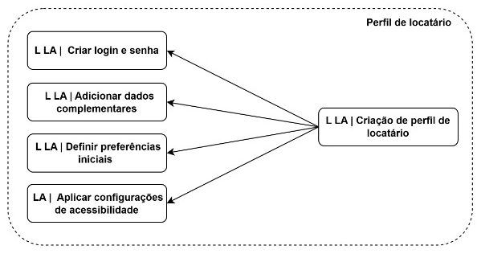
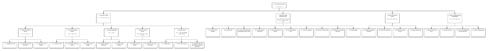
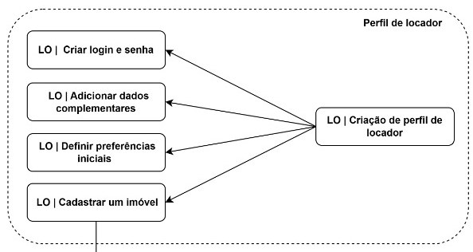
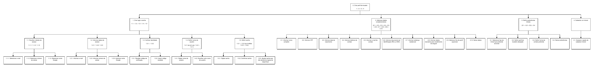
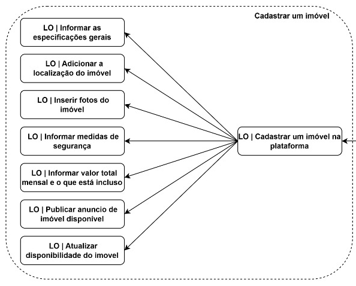
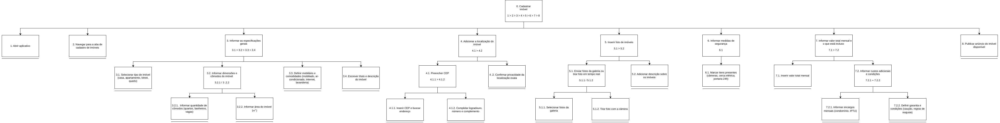
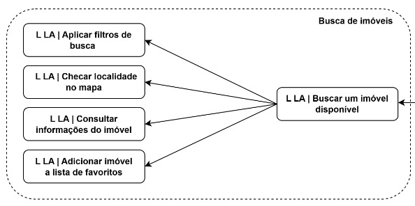
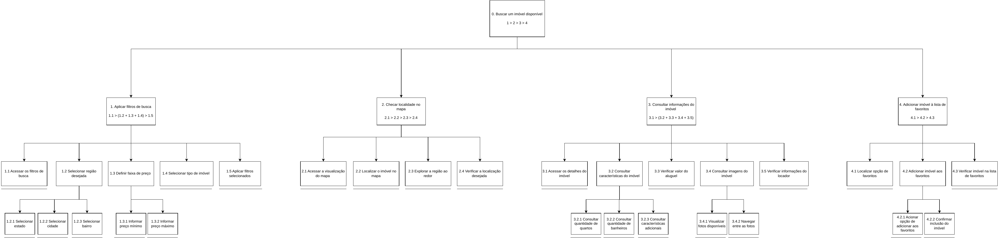
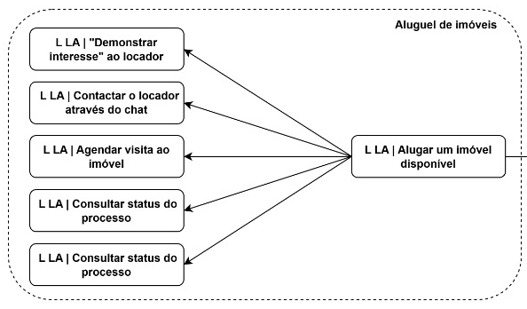
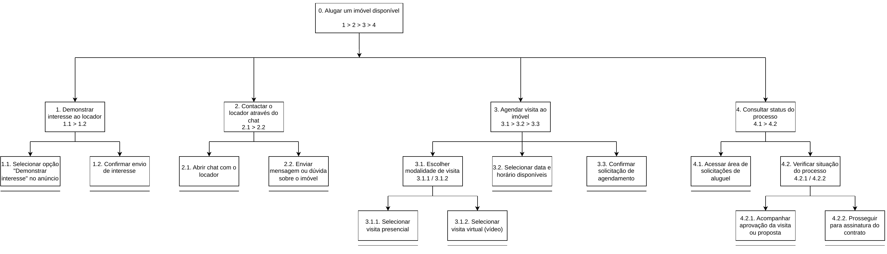

# HTAs

Os HTAs (Hierarchical Task Analysis) modelam as tarefas dos usuários a partir dos objetivos do mapa de objetivos (`3-mapa-de-objetivos.md`). Foram produzidos **cinco HTAs**, cada um associado a um objetivo principal do mapa. Em cada seção, o grupo correspondente do mapa aparece acima do HTA, seguido da descrição detalhada. As imagens dos HTAs são largas: abra-as em tamanho original para ler.

**Notação dos planos:** `>` indica sequência; `+` indica tarefas realizadas em qualquer ordem; `/` indica escolha entre alternativas; `(se ...)` indica uma condição.

| HTA | Objetivo do mapa | Papéis | Personas |
|---|---|---|---|
| 1. Criar perfil de locatário | Criação de perfil de locatário | L, LA | Davi, Isabela e Thiago |
| 2. Criar perfil de locador | Criação de perfil de locador | LO | Antônio |
| 3. Cadastrar imóvel | Cadastrar um imóvel na plataforma | LO | Antônio |
| 4. Buscar um imóvel disponível | Buscar um imóvel disponível | L, LA | Davi, Isabela e Thiago |
| 5. Alugar um imóvel disponível | Alugar um imóvel disponível | L, LA | Davi, Isabela e Thiago |

---

## 1. Criar perfil de locatário

**Objetivo no mapa**

**HTA**

*Clique na imagem para ampliar.*

### Descrição

**Propósito.** Permitir que o estudante crie sua conta e seu perfil para usar a plataforma e, no caso do locatário com necessidade de acessibilidade, ajuste a interface às suas necessidades.

**Tarefas e subtarefas.** A tarefa principal (0) segue o plano `1 > 2 > 3 > 4`.

- **1. Criar login e senha** (`1.1 > 1.2 > 1.3 > 1.4 > 1.5`): o usuário escolhe o método de acesso (1.1: e-mail, número de celular ou conta Google), informa os dados de acesso correspondentes (1.2), verifica a identidade recebendo e inserindo um código (1.3), define o nome de usuário (1.4) e define a senha, digitando e confirmando (1.5).
- **2. Adicionar dados complementares** (`(2.1 + ... + 2.9) > 2.10`): informa nome completo, CPF, documento de identificação (RG ou CNH), data de nascimento, telefone de contato, endereço atual, ocupação e renda mensal, e adiciona uma foto de perfil (opcional). Em seguida, salva os dados (2.10).
- **3. Definir preferências iniciais** (`(3.1 + 3.2 + 3.3) > 3.4`): seleciona a região de interesse, define a faixa de preço e seleciona o tipo de imóvel. Em seguida, salva as preferências.
- **4. Aplicar configurações de acessibilidade** (`(4.1 + 4.2 + 4.3) > 4.4`): ajusta o tamanho da fonte e o contraste, ativa a compatibilidade com leitor de tela e salva as configurações.

**Decisões envolvidas.**
- A escolha do método de acesso (1.1) define quais dados são informados em 1.2.
- Se o nome de usuário já estiver em uso, o usuário escolhe outro (1.4.2) e volta a digitá-lo (1.4.1).
- Se a senha não atender às regras de segurança, o usuário a ajusta (1.5.3) e a confirma de novo (1.5.2).
- A etapa 4 é do papel LA (locatário com necessidade de acessibilidade), conforme o mapa.

**Contribuição para o fluxo.** O login dá acesso à plataforma. Os dados complementares compõem o perfil que o locador consulta ao confirmar uma locação ("Checar perfil do locatário"). As preferências (região, faixa de preço e tipo de imóvel) correspondem aos filtros do HTA de busca. As configurações de acessibilidade atendem à persona Thiago, com baixa visão e dificuldade motora nas mãos.

### Cobertura do mapa

| Sub-objetivo no mapa | Papéis | Nó no HTA |
|---|---|---|
| Criar login e senha | L LA | 1 |
| Adicionar dados complementares | L LA | 2 |
| Definir preferências iniciais | L LA | 3 |
| Aplicar configurações de acessibilidade | LA | 4 |

---

## 2. Criar perfil de locador

**Objetivo no mapa**

**HTA**

*Clique na imagem para ampliar.*

### Descrição

**Propósito.** Permitir que o locador crie sua conta e seu perfil, para que possa anunciar imóveis e ser identificado pelos interessados.

**Tarefas e subtarefas.** A tarefa principal (0) segue o plano `1 > 2 > 3 > 4`.

- **1. Criar login e senha** (`1.1 > 1.2 > 1.3 > 1.4 > 1.5`): igual ao do locatário, com escolha do método de acesso, dados de acesso, verificação de identidade por código, nome de usuário e senha.
- **2. Adicionar dados complementares** (`(2.1 + ... + 2.9) > 2.10`): informa nome completo, CPF, data de nascimento, telefone de contato, e-mail de contato, documento de identificação (RG ou CNH), endereço residencial e dados bancários para recebimento do aluguel, e adiciona uma foto de perfil (opcional). Em seguida, salva os dados (2.10).
- **3. Definir preferências iniciais** (`(3.1 + 3.2 + 3.3) > 3.4`): seleciona o tipo de imóvel que pretende anunciar, define o perfil de locatário desejado e a forma de contato preferida, e salva as preferências.
- **4. Cadastrar um imóvel** (4.1): acessa a opção de cadastrar imóvel, o que leva ao HTA 3.

**Decisões envolvidas.** As mesmas do login do locatário (método de acesso, nome de usuário em uso e senha fora das regras). A definição do perfil de locatário desejado (3.2) permite ao locador indicar para quem pretende alugar.

**Contribuição para o fluxo.** O perfil identifica quem anuncia, e as informações do locador são consultadas pelo estudante ao ver um imóvel (HTA 4, nó 3.5). O CPF atende à sugestão dos locadores no briefing, de pedir ao menos o CPF no cadastro. O perfil de locatário desejado reflete a intenção dos locadores de alugar somente para estudantes, e a forma de contato preferida dá base para receber os avisos de interessados.

### Cobertura do mapa

| Sub-objetivo no mapa | Papéis | Nó no HTA |
|---|---|---|
| Criar login e senha | LO | 1 |
| Adicionar dados complementares | LO | 2 |
| Definir preferências iniciais | LO | 3 |
| Cadastrar um imóvel | LO | 4 (detalhado no HTA 3) |

---

## 3. Cadastrar imóvel

**Objetivo no mapa**

**HTA**

*Clique na imagem para ampliar.*

### Descrição

**Propósito.** Permitir que o locador crie e publique o anúncio de um imóvel, com as informações que os estudantes consideram indispensáveis para escolher: localização, fotos, segurança e valor total.

**Tarefas e subtarefas.** A tarefa principal (0) segue o plano `1 > 2 > 3 > 4 > 5 > 6 > 7 > 8`.

- **1. Abrir aplicativo** e **2. Navegar para a aba de cadastro de imóveis.**
- **3. Informar as especificações gerais** (`3.1 > 3.2 > 3.3 > 3.4`): seleciona o tipo de imóvel (casa, apartamento, kitnet ou quarto), informa as dimensões e os cômodos (quantidade de cômodos, como quartos, banheiros e vagas, e a área em m²), define o mobiliário e as comodidades (mobiliado, ar-condicionado, internet, lavanderia) e escreve o título e a descrição.
- **4. Adicionar a localização do imóvel** (`4.1 > 4.2`): preenche o CEP, inserindo-o e buscando o endereço (4.1.1) e completando logradouro, número e complemento (4.1.2), e confirma a privacidade da localização exata (4.2).
- **5. Inserir fotos do imóvel** (`5.1 > 5.2`): envia fotos, selecionando da galeria (5.1.1) ou tirando na hora com a câmera (5.1.2), e adiciona uma descrição.
- **6. Informar medidas de segurança** (6.1): marca os itens presentes (câmeras, cerca elétrica, portaria 24h).
- **7. Informar valor total mensal e o que está incluso** (`7.1 > 7.2`): insere o valor total mensal (7.1) e informa custos adicionais e condições (7.2), que incluem os encargos mensais (condomínio, IPTU) e a garantia e condições (caução, regras de reajuste).
- **8. Publicar anúncio do imóvel disponível.**

**Decisões envolvidas.** As fotos podem vir da galeria ou da câmera (5.1.1 ou 5.1.2). O locador decide se mostra ou não a localização exata (4.2), e quais medidas de segurança e custos adicionais informar.

**Contribuição para o fluxo.** O anúncio publicado é o que o estudante encontra no HTA 4: a localização (4) alimenta a checagem no mapa (HTA 4, nó 2), o tipo, as dimensões e as comodidades (3) aparecem nas características do imóvel (HTA 4, nó 3.2), o valor (7) é consultado em HTA 4, nó 3.3, e as fotos (5) são vistas em HTA 4, nó 3.4. As medidas de segurança atendem a um critério central dos estudantes (segurança foi citada por 11 de 13 participantes da pesquisa) e à prática dos locadores de manter câmeras nas áreas comuns, relatada no briefing.

### Cobertura do mapa

| Sub-objetivo no mapa | Papéis | Nó no HTA |
|---|---|---|
| Informar as especificações gerais | LO | 3 |
| Adicionar a localização do imóvel | LO | 4 |
| Inserir fotos do imóvel | LO | 5 |
| Informar medidas de segurança | LO | 6 |
| Informar valor total mensal e o que está incluso | LO | 7 |
| Publicar anúncio de imóvel disponível | LO | 8 |
| Atualizar disponibilidade do imóvel | LO | Não detalhado neste HTA (ver pontos a validar) |

---

## 4. Buscar um imóvel disponível

**Objetivo no mapa**

**HTA**

*Clique na imagem para ampliar.*

### Descrição

**Propósito.** Permitir que o estudante encontre, avalie e guarde imóveis disponíveis que atendam às suas necessidades de preço, localização e informações.

**Tarefas e subtarefas.** A tarefa principal (0) segue o plano `1 > 2 > 3 > 4`.

- **1. Aplicar filtros de busca** (`1.1 > (1.2 + 1.3 + 1.4) > 1.5`): acessa os filtros (1.1), seleciona a região desejada (estado, cidade e bairro), define a faixa de preço (mínimo e máximo) e seleciona o tipo de imóvel, e aplica os filtros selecionados (1.5).
- **2. Checar localidade no mapa** (`2.1 > 2.2 > 2.3 > 2.4`): acessa a visualização do mapa, localiza o imóvel, explora a região ao redor e verifica a localização desejada.
- **3. Consultar informações do imóvel** (`3.1 > (3.2 + 3.3 + 3.4 + 3.5)`): acessa os detalhes do imóvel (3.1) e consulta, em qualquer ordem, as características (quantidade de quartos, de banheiros e características adicionais), o valor do aluguel, as imagens (visualizando as fotos e navegando entre elas) e as informações do locador.
- **4. Adicionar imóvel à lista de favoritos** (`4.1 > 4.2 > 4.3`): localiza a opção de favoritos, adiciona o imóvel (acionando a opção e confirmando a inclusão) e verifica o imóvel na lista de favoritos.

**Decisões envolvidas.** Quais filtros aplicar (região, preço e tipo são independentes entre si), se o imóvel merece ser explorado no mapa, quais informações consultar e se o imóvel entra na lista de favoritos.

**Contribuição para o fluxo.** É o ponto de partida da locação: os filtros reaproveitam as preferências definidas no perfil (HTA 1, nó 3), e o imóvel escolhido leva ao HTA 5, no qual o estudante demonstra interesse. As informações consultadas respondem ao que a pesquisa mostrou ser indispensável: endereço e mapa (12 de 13), valor (12 de 13) e fotos de todos os cômodos (11 de 13).

### Cobertura do mapa

| Sub-objetivo no mapa | Papéis | Nó no HTA |
|---|---|---|
| Aplicar filtros de busca | L LA | 1 |
| Checar localidade no mapa | L LA | 2 |
| Consultar informações do imóvel | L LA | 3 |
| Adicionar imóvel à lista de favoritos | L LA | 4 |

---

## 5. Alugar um imóvel disponível

**Objetivo no mapa**

**HTA**

*Clique na imagem para ampliar.*

### Descrição

**Propósito.** Permitir que o estudante avance, a partir de um imóvel escolhido, do interesse até a formalização da locação: manifestar interesse, conversar com o locador, agendar a visita e acompanhar o andamento do processo.

**Tarefas e subtarefas.** A tarefa principal (0) segue o plano `1 > 2 > 3 > 4`.

- **1. Demonstrar interesse ao locador** (`1.1 > 1.2`): seleciona a opção "Demonstrar interesse" no anúncio e confirma o envio.
- **2. Contactar o locador através do chat** (`2.1 > 2.2`): abre o chat com o locador e envia uma mensagem ou dúvida sobre o imóvel.
- **3. Agendar visita ao imóvel** (`3.1 > 3.2 > 3.3`): escolhe a modalidade de visita (presencial, 3.1.1, ou virtual por vídeo, 3.1.2), seleciona a data e o horário disponíveis (3.2) e confirma a solicitação de agendamento (3.3).
- **4. Consultar status do processo** (`4.1 > 4.2`): acessa a área de solicitações de aluguel (4.1) e verifica a situação do processo (4.2), acompanhando a aprovação da visita ou da proposta (4.2.1) ou prosseguindo para a assinatura do contrato (4.2.2).

**Decisões envolvidas.** A modalidade da visita (presencial ou virtual) e, ao consultar o status, a escolha entre acompanhar a aprovação e prosseguir para o contrato, conforme a situação do processo.

**Contribuição para o fluxo.** Conecta o estudante ao locador. O interesse demonstrado gera o aviso que o locador acessa em "Confirmar locação", a visita agendada é confirmada pelo locador, e a assinatura do contrato leva ao objetivo compartilhado "Formalizar contrato de locação". A visita virtual atende a quem não consegue visitar o imóvel antes (3 de 13 participantes da pesquisa apontaram essa dificuldade), e o aviso de interesse responde a uma prioridade do locador no briefing.

### Cobertura do mapa

| Sub-objetivo no mapa | Papéis | Nó no HTA |
|---|---|---|
| "Demonstrar interesse" ao locador | L LA | 1 |
| Contactar o locador através do chat | L LA | 2 |
| Agendar visita ao imóvel | L LA | 3 |
| Consultar status do processo | L LA | 4 |

