# Diagramas MoLIC

Os diagramas MoLIC (Modeling Language for Interaction as Conversation) representam a interação entre o usuário e o sistema como uma conversa. Foram modelados **cinco diagramas**, um para cada HTA: criação do perfil de locatário, criação do perfil de locador, busca de imóvel, cadastro do imóvel e aluguel de imóvel.

## Notação

| Elemento | Significado |
|---|---|
| Círculo preto | Início da interação |
| Círculo com borda dupla | Fim da interação |
| Retângulo arredondado com título | Cena: momento da conversa em que usuário e sistema trocam falas |
| Retângulo cinza | Acesso ubíquo: cena de onde o usuário pode acionar uma fala, como cancelar, a partir de qualquer ponto do fluxo |
| Seta contínua com **u:** | Transição provocada por uma fala do usuário |
| Quadrado preto | Processamento do sistema |
| Seta com **d:** | Resposta do designer, apresentada pelo sistema |
| Seta tracejada | Recuperação de ruptura: o fluxo volta à cena para corrigir o problema |
| **u:** / **d:** / **d+u:** | Fala do usuário / fala do designer / diálogo em que designer e usuário alternam |
| SEQ, XOR, OR | Falas em sequência, escolha de uma única opção e escolha de uma ou mais opções |

## Visão geral

A imagem reúne os cinco diagramas, mostrando a modelagem geral da interação.

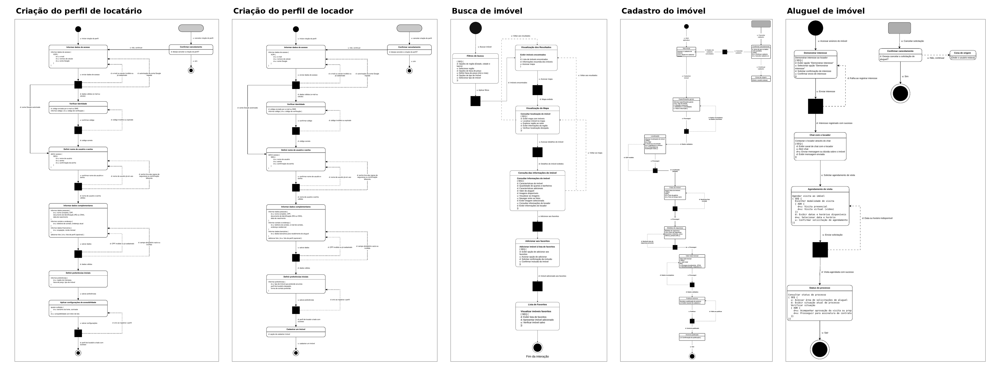

| Diagrama | HTA | Sketches | Personas |
|---|---|---|---|
| 1. Criação do perfil de locatário | HTA 1 | Telas 1 e 2 | Davi, Isabela e Thiago |
| 2. Criação do perfil de locador | HTA 2 | Tela 1 | Antônio |
| 3. Busca de imóvel | HTA 4 | Telas 3 e 4 | Davi, Isabela e Thiago |
| 4. Cadastro do imóvel | HTA 3 | Tela 5 | Antônio |
| 5. Aluguel de imóvel | HTA 5 | Tela 4 (botões Demonstrar interesse e Chat) | Davi, Isabela e Thiago |

---

## 1. Criação do perfil de locatário

Modela a criação da conta e do perfil do estudante, do acesso à plataforma até a configuração da acessibilidade. Corresponde ao HTA 1.

### Parte 1: acesso, verificação de identidade e cancelamento

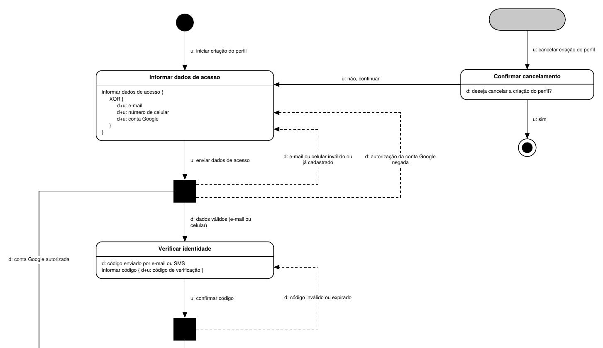

- **Informar dados de acesso.** A interação começa quando o usuário decide iniciar a criação do perfil (**u: iniciar criação do perfil**). Nesta cena, o usuário escolhe um único método de acesso (XOR): e-mail, número de celular ou conta Google. Ao enviar os dados (**u: enviar dados de acesso**), o sistema processa o pedido. Se o e-mail ou celular for inválido ou já estiver cadastrado, ou se a autorização da conta Google for negada, o fluxo volta à cena por recuperação de ruptura. Com e-mail ou celular válidos, segue para a verificação de identidade. Com a conta Google autorizada, vai direto para a definição de nome de usuário e senha.
- **Verificar identidade.** O sistema informa que enviou um código por e-mail ou SMS, e o usuário informa o código de verificação (**u: confirmar código**). Um código inválido ou expirado devolve o usuário à mesma cena. Com o código correto, o fluxo segue para a definição de nome de usuário e senha.
- **Confirmar cancelamento.** Acessível a partir de qualquer ponto pelo acesso ubíquo (**u: cancelar criação do perfil**). O sistema pergunta se o usuário deseja cancelar a criação do perfil. Com **u: sim**, a interação termina. Com **u: não, continuar**, o usuário retorna ao fluxo de criação do perfil.

### Parte 2: nome de usuário, senha e dados complementares

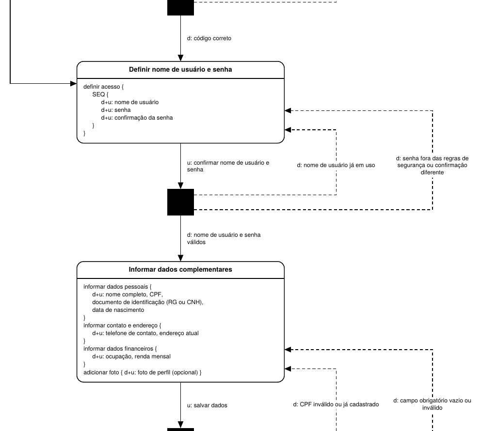

- **Definir nome de usuário e senha.** O usuário informa, em sequência (SEQ), o nome de usuário, a senha e a confirmação da senha, e confirma (**u: confirmar nome de usuário e senha**). Se o nome de usuário já estiver em uso, ou se a senha estiver fora das regras de segurança ou a confirmação for diferente, o fluxo volta à cena. Com os dados válidos, segue para os dados complementares.
- **Informar dados complementares.** O usuário preenche quatro grupos de informação: dados pessoais (nome completo, CPF, documento de identificação, RG ou CNH, e data de nascimento), contato e endereço (telefone de contato e endereço atual), dados financeiros (ocupação e renda mensal) e uma foto de perfil, que é opcional. Ao salvar (**u: salvar dados**), o sistema valida as informações. CPF inválido ou já cadastrado, ou campo obrigatório vazio ou inválido, devolvem o usuário à cena. Com os dados válidos, o fluxo segue para as preferências.

### Parte 3: preferências, acessibilidade e fim

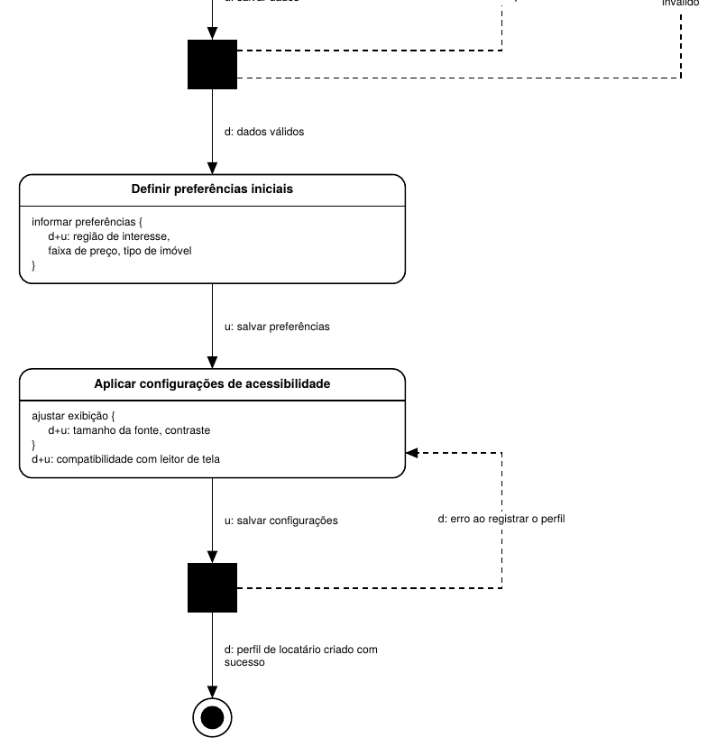

- **Definir preferências iniciais.** O usuário informa a região de interesse, a faixa de preço e o tipo de imóvel, e salva (**u: salvar preferências**). O fluxo segue para a acessibilidade.
- **Aplicar configurações de acessibilidade.** O usuário ajusta a exibição (tamanho da fonte e contraste) e a compatibilidade com leitor de tela, e salva (**u: salvar configurações**). Se houver erro ao registrar o perfil, o fluxo volta à cena. Com sucesso, o sistema informa que o perfil de locatário foi criado e a interação termina.

---

## 2. Criação do perfil de locador

Modela a criação da conta e do perfil do locador, até a abertura do cadastro de um imóvel. Corresponde ao HTA 2. Tem a mesma estrutura do diagrama do locatário, com dados e cenas finais próprios.

### Parte 1: acesso, verificação de identidade e cancelamento

As cenas **Informar dados de acesso**, **Verificar identidade** e **Confirmar cancelamento** são iguais às do diagrama do locatário, com as mesmas falas, rupturas e transições: escolha entre e-mail, celular ou conta Google, envio e verificação do código, e confirmação do cancelamento da criação do perfil.

### Parte 2: nome de usuário, senha e dados complementares

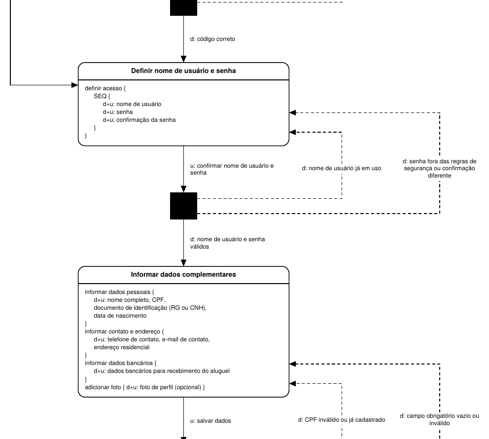

- **Definir nome de usuário e senha.** Igual à do locatário: nome de usuário, senha e confirmação, com recuperação para nome já em uso e senha fora das regras.
- **Informar dados complementares.** O locador informa dados pessoais (nome completo, CPF, documento de identificação e data de nascimento), contato e endereço (telefone, e-mail de contato e endereço residencial), dados bancários para recebimento do aluguel e uma foto de perfil opcional. Ao salvar, CPF inválido ou já cadastrado e campos obrigatórios vazios ou inválidos devolvem o usuário à cena.

### Parte 3: preferências e abertura do cadastro de imóvel

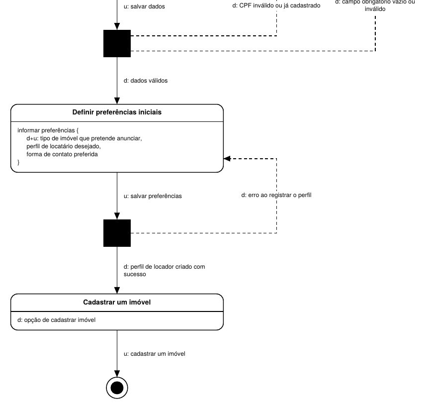

- **Definir preferências iniciais.** O locador informa o tipo de imóvel que pretende anunciar, o perfil de locatário desejado e a forma de contato preferida, e salva (**u: salvar preferências**). Se houver erro ao registrar o perfil, o fluxo volta à cena. Com sucesso, o sistema informa que o perfil de locador foi criado.
- **Cadastrar um imóvel.** O sistema oferece a opção de cadastrar imóvel, e o usuário a aciona (**u: cadastrar um imóvel**). Esta fala encerra o diagrama e leva ao MoLIC de cadastro do imóvel.

---

## 3. Busca de imóvel

Modela como o estudante encontra imóveis, explora a localização, consulta os detalhes e guarda os favoritos. Corresponde ao HTA 4.

### Parte 1: filtros de busca e resultados

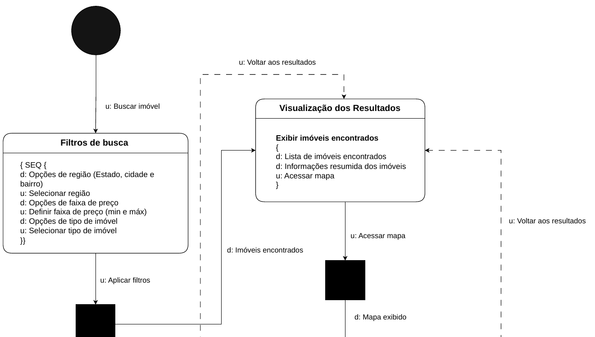

- **Filtros de busca.** A interação começa com **u: buscar imóvel**. Em sequência (SEQ), o sistema oferece as opções de região (estado, cidade e bairro), de faixa de preço e de tipo de imóvel, e o usuário seleciona a região, define o preço mínimo e o máximo e escolhe o tipo. Ao aplicar os filtros (**u: aplicar filtros**), o sistema processa a busca e responde que encontrou imóveis.
- **Visualização dos resultados.** O sistema exibe a lista de imóveis encontrados com informações resumidas de cada um. O usuário pode acessar o mapa (**u: acessar mapa**), e o sistema responde que o mapa foi exibido. Dessa cena também se volta aos resultados a partir do mapa e dos detalhes (**u: voltar aos resultados**).

### Parte 2: mapa e informações do imóvel

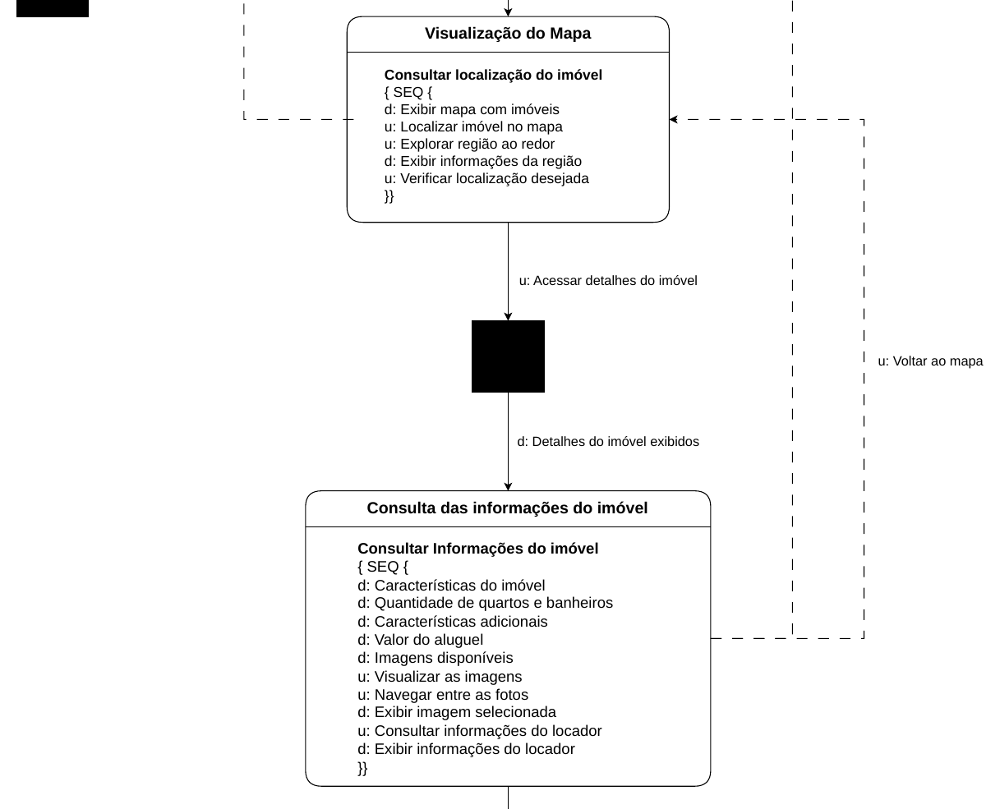

- **Visualização do mapa.** Em sequência, o sistema exibe o mapa com os imóveis, o usuário localiza um imóvel no mapa e explora a região ao redor, o sistema exibe informações da região e o usuário verifica a localização desejada. Ao acessar os detalhes do imóvel (**u: acessar detalhes do imóvel**), o sistema responde que os detalhes foram exibidos. O usuário pode voltar aos resultados (**u: voltar aos resultados**).
- **Consulta das informações do imóvel.** O sistema apresenta as características do imóvel, a quantidade de quartos e banheiros, as características adicionais, o valor do aluguel e as imagens disponíveis. O usuário visualiza e navega entre as fotos, e o sistema exibe a imagem selecionada. O usuário também consulta as informações do locador, que o sistema exibe. Desta cena, o usuário pode voltar ao mapa (**u: voltar ao mapa**), voltar aos resultados (**u: voltar aos resultados**) ou adicionar o imóvel aos favoritos (**u: adicionar aos favoritos**).

### Parte 3: favoritos e fim da interação

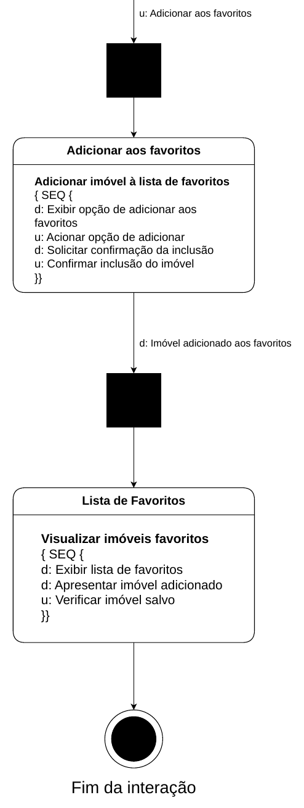

- **Adicionar aos favoritos.** Em sequência, o sistema exibe a opção de adicionar aos favoritos, o usuário a aciona, o sistema solicita a confirmação da inclusão e o usuário confirma. O sistema informa que o imóvel foi adicionado aos favoritos.
- **Lista de favoritos.** O sistema exibe a lista de favoritos e apresenta o imóvel adicionado, e o usuário verifica o imóvel salvo. A interação termina.

---

## 4. Cadastro do imóvel

Modela o cadastro de um imóvel pelo locador, etapa por etapa, até a publicação do anúncio. Corresponde ao HTA 3.

### Parte 1: tela inicial, especificações gerais e cancelamento

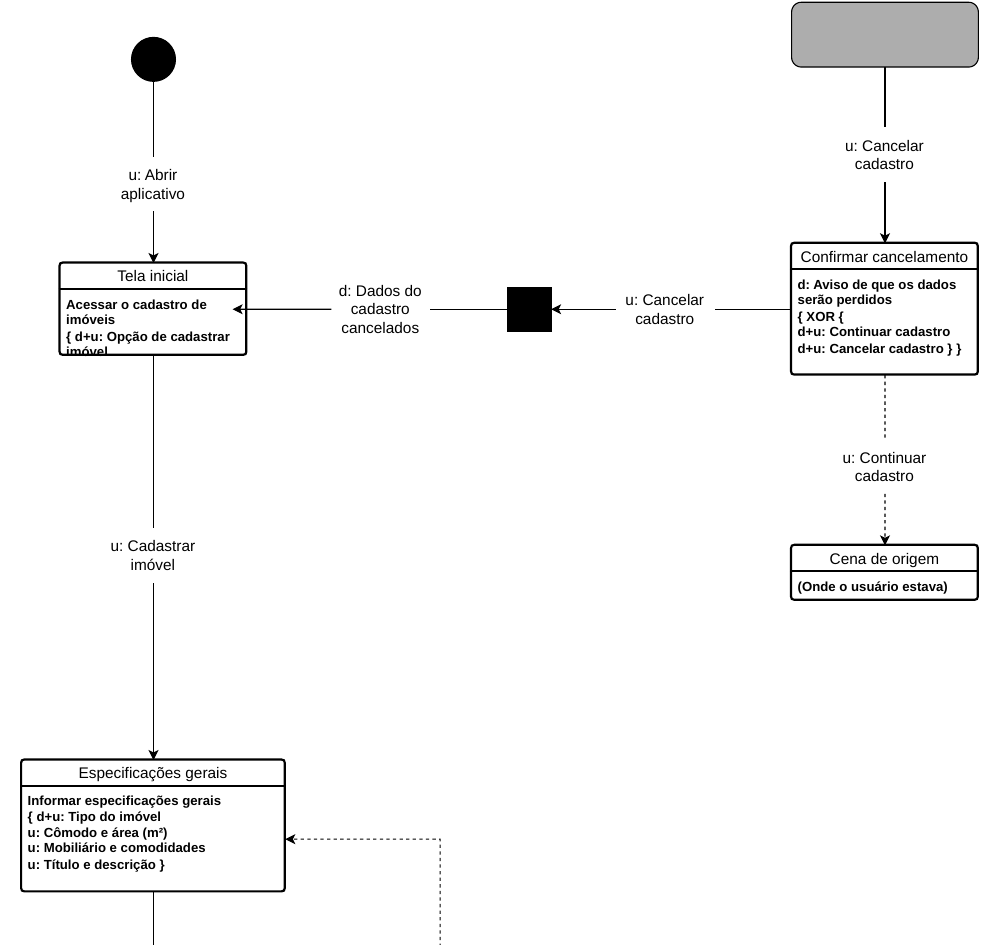

- **Tela inicial.** A interação começa quando o usuário abre o aplicativo (**u: abrir aplicativo**). O sistema oferece a opção de cadastrar imóvel, e o usuário a aciona (**u: cadastrar imóvel**).
- **Especificações gerais.** O usuário informa o tipo do imóvel, a quantidade de cômodos e a área (m²), o mobiliário e as comodidades, e o título e a descrição. Ao prosseguir (**u: prosseguir**), o sistema valida os dados. Se estiverem incompletos ou incorretos, o fluxo volta à cena. Com os dados validados, segue para a localização.
- **Confirmar cancelamento.** Acessível a qualquer momento pelo acesso ubíquo (**u: cancelar cadastro**). O sistema avisa que os dados serão perdidos, e o usuário escolhe entre continuar o cadastro, o que o devolve à cena em que estava (cena de origem), e cancelar o cadastro, o que apaga os dados e o leva de volta à tela inicial.

### Parte 2: localização e fotos

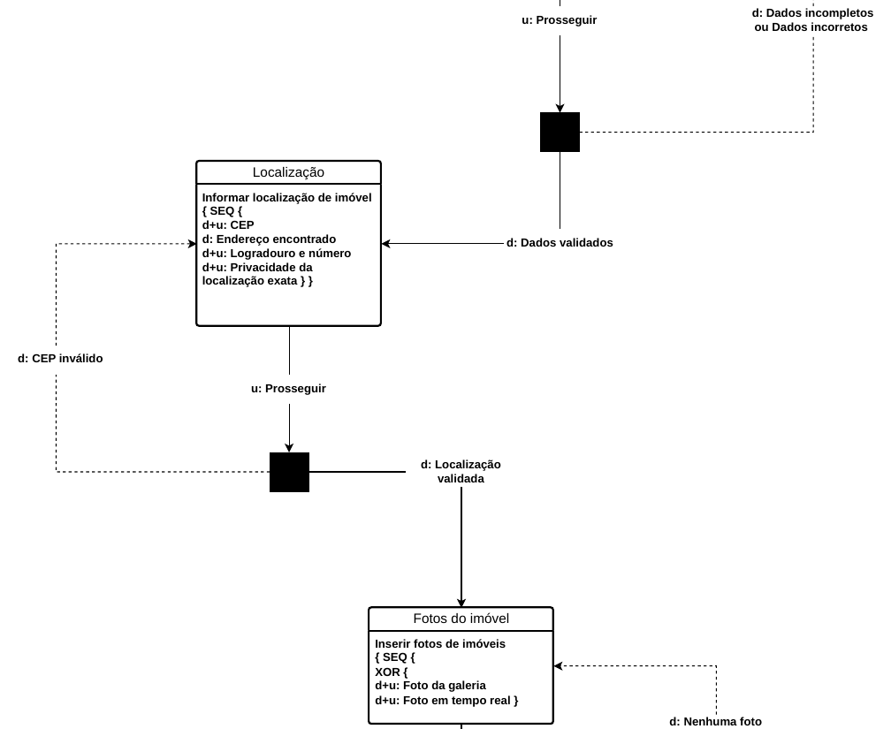

- **Localização.** Em sequência, o usuário informa o CEP, o sistema encontra o endereço, e o usuário informa o logradouro e o número e define a privacidade da localização exata. Ao prosseguir, um CEP inválido devolve o fluxo à cena. Com a localização validada, segue para as fotos.
- **Fotos do imóvel.** O usuário escolhe uma foto da galeria ou tira uma foto em tempo real (XOR). Se nenhuma foto for enviada, o fluxo volta à cena. Ao prosseguir com ao menos uma foto, segue para as medidas de segurança.

### Parte 3: medidas de segurança e valor total mensal

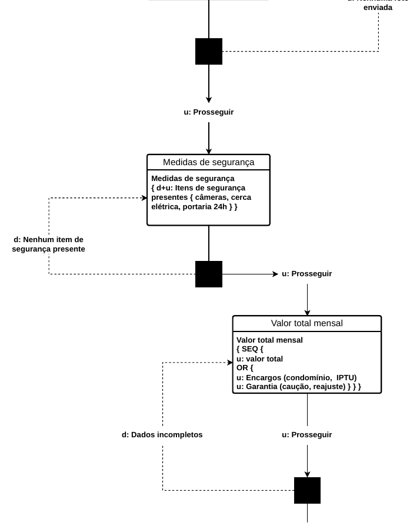

- **Medidas de segurança.** O usuário marca os itens de segurança presentes (câmeras, cerca elétrica e portaria 24h). Se nenhum item for marcado, o sistema sinaliza que não há item de segurança e o fluxo volta à cena. Ao prosseguir, segue para o valor.
- **Valor total mensal.** O usuário informa o valor total e, de forma inclusiva (OR), os encargos (condomínio e IPTU) e a garantia (caução e reajuste). Ao prosseguir, dados incompletos devolvem o fluxo à cena.

### Parte 4: publicação do anúncio

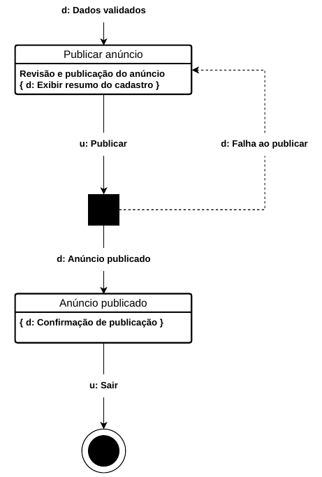

- **Publicar anúncio.** Com os dados validados, o sistema exibe o resumo do cadastro para revisão, e o usuário publica o anúncio (**u: publicar**). Se houver falha ao publicar, o fluxo volta à cena.
- **Anúncio publicado.** O sistema confirma a publicação, e o usuário sai (**u: sair**), o que encerra a interação.

---

## 5. Aluguel de imóvel

Modela o caminho do estudante, a partir de um anúncio, do interesse no imóvel ao acompanhamento do processo. Corresponde ao HTA 5.

### Parte 1: interesse, chat e cancelamento

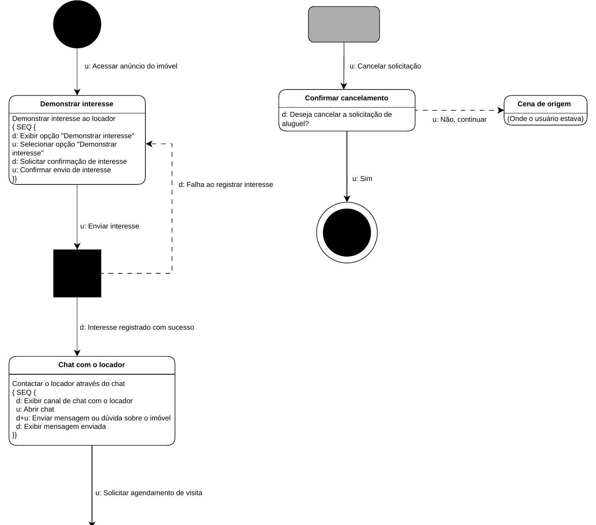

- **Demonstrar interesse.** A interação começa quando o usuário acessa o anúncio do imóvel (**u: acessar anúncio do imóvel**). Em sequência, o sistema exibe a opção "Demonstrar interesse", o usuário a seleciona, o sistema solicita a confirmação de interesse e o usuário confirma o envio. Ao enviar o interesse (**u: enviar interesse**), uma falha ao registrá-lo devolve o fluxo à cena. Com o interesse registrado com sucesso, segue para o chat.
- **Chat com o locador.** Em sequência, o sistema exibe o canal de chat, o usuário o abre, envia uma mensagem ou dúvida sobre o imóvel e o sistema exibe a mensagem enviada. Ao solicitar o agendamento de visita (**u: solicitar agendamento de visita**), o fluxo segue para o agendamento.
- **Confirmar cancelamento.** Acessível a partir de qualquer ponto pelo acesso ubíquo (**u: cancelar solicitação**). O sistema pergunta se o usuário deseja cancelar a solicitação de aluguel. Com **u: sim**, a interação termina. Com **u: não, continuar**, o usuário volta à cena em que estava.

### Parte 2: agendamento de visita e status do processo

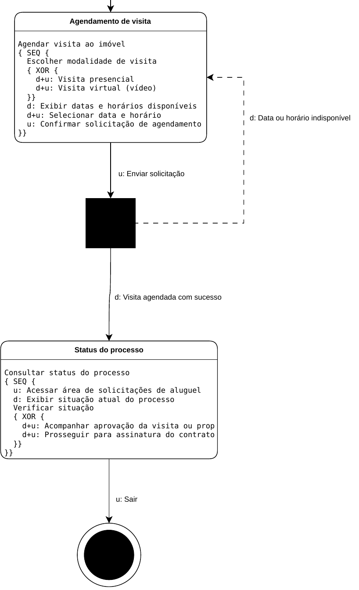

- **Agendamento de visita.** Em sequência, o usuário escolhe a modalidade da visita (XOR: presencial ou virtual por vídeo), o sistema exibe as datas e os horários disponíveis, o usuário seleciona uma data e um horário e confirma a solicitação. Ao enviar a solicitação (**u: enviar solicitação**), uma data ou horário indisponível devolve o fluxo à cena. Com a visita agendada com sucesso, segue para o status do processo.
- **Status do processo.** Em sequência, o usuário acessa a área de solicitações de aluguel, o sistema exibe a situação atual do processo e o usuário verifica a situação, escolhendo entre acompanhar a aprovação da visita ou da proposta e prosseguir para a assinatura do contrato (XOR). O usuário sai (**u: sair**), e a interação termina.

